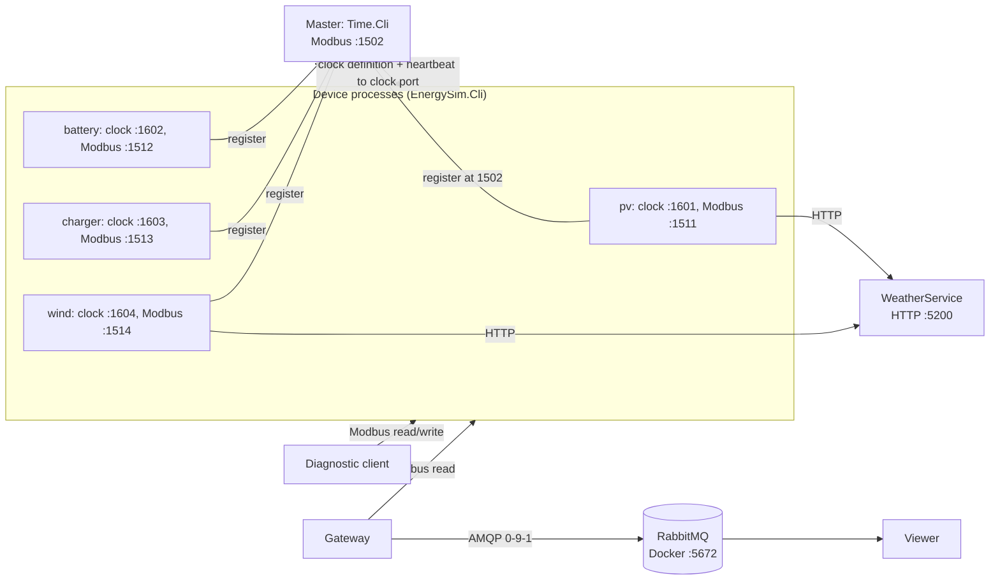
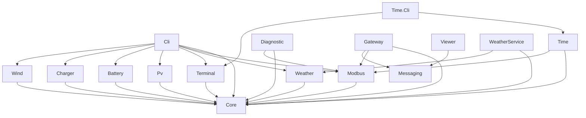

# EnergySim

Distributed energy simulation, LB02. Separate processes on one machine:
- master (time service): owns virtual time
- weather service: one weather for all (HTTP)
- 4 field device simulators: PV, battery, charger, wind (each with its own Modbus server)
- diagnostic client: reads and writes devices over Modbus

## Prerequisites
- .NET 10 SDK (`global.json`)
- No internet at runtime: weather data lies in the repo (`src/EnergySim.Weather/data`)

## Build and test
```bash
dotnet build EnergySim.sln
dotnet test EnergySim.sln
scripts/testrun_task2.sh   # opens master, weather, 4 devices and the diagnostic client in own terminal windows (pv2 adds a second PV, stop ends all)
```
`legacy/` is reference only, not part of the build.

## Architecture

Contract for registers and ports: [docs/contracts/modbus-registers.md](docs/contracts/modbus-registers.md)
Message contract and routing: [docs/contracts/messaging.md](docs/contracts/messaging.md). Requirements: [docs/SRS-LB03.md](docs/SRS-LB03.md).

## Simulator owners
| Person | Simulators |
|---|---|
| Jakob | PV, WeatherSim |
| Jonas | Battery, Wind |
| Leon | TimeSim, Dual-Port-Charger |

## Time synchronisation
- Master is the only authority for virtual time, devices never integrate their own time
- Device registers its clock port at the master (1502), master connects back
- Master sends clock definitions (anchor, speed, status) at a common future instant, plus a heartbeat every 1 s
- Device computes virtual time from the definition and its monotonic counter
- Master gone: device keeps running on its last definition, shows a warning, retries

Details: [modbus-virtual-time.md](docs/architecture/modbus-virtual-time.md), [contracts/time.md](docs/contracts/time.md)

## Weather
- One HTTP process, stateless, reference year 2025 for 3 locations (`salzburg`, `wien`, `innsbruck`)
- Query: location + virtual time, client floors the time to the full minute -> same values for all devices
- Service down: last valid value with `stale`. Details: [contracts/weather.md](docs/contracts/weather.md)

## Modules
Owner = main responsible person.

| Project | Purpose | Owner |
|---|---|---|
| `Core` | Device contract, clock model, simulation loop, CSV, register map and codec | shared |
| `Weather` | Weather model, data files, HTTP client | Jakob |
| `WeatherService` | Weather HTTP process | Jakob |
| `Modbus` | Clock transport and per-device Modbus server (EasyModbus behind async boundary) | Jonas (device layer), Leon (clock transport) |
| `Time` | Time authority and participant host | Leon |
| `Time.Cli` | Master executable: dashboard, headless mode | Leon |
| `Terminal` | Shared dashboard, key source, log buffer, headless writer | Leon |
| `Pv` | PV model and adapter | Jakob |
| `Battery` | Battery model and adapter | Jonas |
| `Charger` | Charger model and adapter | Leon |
| `Wind` | Wind model and adapter | Jonas |
| `Cli` | Device executable: composition of clock, model, weather, Modbus server, UI | Jakob |
| `Diagnostic` | Modbus diagnostic client | Jakob |
| `Messaging` | Telemetry message, routing, RabbitMQ wrapper (only project with RabbitMQ.Client) | open |
| `Gateway` | Modbus client, publishes device states to RabbitMQ | Leon |
| `Viewer` | RabbitMQ consumer, console output | open |
| `tests/EnergySim.Tests` | xUnit tests | shared |

Each project: own `README.md` under `src/<project>/`.

## Project references
Arrows = `ProjectReference` in the csproj. No cycles, everything ends in `Core`.

Tests reference Core, Weather, Terminal, Pv, Wind, Battery, Charger, Cli, Time, Time.Cli.

## Start order
Repository root, one terminal each. Ports below 1502 are rejected.

1. Master (clock stays stopped until `P`)
   ```bash
   dotnet run --project src/EnergySim.Time.Cli
   ```
   Clock port 1502
2. Weather service (needed by PV and wind, startup aborts without it)
   ```bash
   dotnet run --project src/EnergySim.WeatherService
   ```
   HTTP 5200
3. Devices (one process each)
   ```bash
   dotnet run --project src/EnergySim.Cli -- --device pv --clock shared
   dotnet run --project src/EnergySim.Cli -- --device battery --clock shared
   dotnet run --project src/EnergySim.Cli -- --device charger --clock shared
   dotnet run --project src/EnergySim.Cli -- --device wind --clock shared
   ```
   Defaults: clock port 1601 pv, 1602 battery, 1603 charger, 1604 wind. Modbus server 1511 to 1514, unit id 1.

   Second instance of a type: other id and both ports
   ```bash
   dotnet run --project src/EnergySim.Cli -- --device pv --id pv-2 --clock shared --clock-port 1611 --Modbus:Port 1521
   ```
   Without `--clock shared` the device runs on a local clock, no sync with the master.
4. Diagnostic client
   ```bash
   dotnet run --project src/EnergySim.Diagnostic
   dotnet run --project src/EnergySim.Diagnostic -- --Host 127.0.0.1 --Port 1512
   ```

5. RabbitMQ, gateway, viewer (LB03)
   ```bash
   cp .env.example .env                 # once, set the password
   docker compose up -d --wait          # broker, see docs/rabbitmq.md
   set -a; source .env; set +a          # RABBITMQ_USER and RABBITMQ_PASSWORD into the shell
   dotnet run --project src/EnergySim.Viewer
   dotnet run --project src/EnergySim.Gateway
   ```
   Everything in own windows: `scripts/testrun_task3.sh`, stop with `scripts/testrun_task3.sh stop`. Broker UI `http://localhost:15672`.

Shutdown: Ctrl+C or `Q` / `quit`, exit code 0. Stop in reverse order. `docker compose down` for the broker.

## Operating hints
- Master keys: `P` start/pause/resume, `V` set speed, `+` `-` speed x2 and /2, `R` restart (`YYYY-MM-DD HH:MM`, local time), `Q` quit
- Master headless: `--headless`, commands per line on stdin: `start`, `pause`, `resume`, `speed <x>`, `restart <yyyy-MM-dd HH:mm>`, `table`, `quit`
- Master table: per device status NEW/OK/UNREACHABLE, last seen, skew
- Device keys: `O` on, `F` off, `L` limit, `T` fault, `R` fault reset, `Q` quit. With `--clock shared` the clock keys are hidden, the master owns them
- Device options: `--id`, `--location`, `--start`, `--speed`, `--weather-url`, `--csv`, `--time-port`, `--clock-port`, `--Modbus:Host`, `--Modbus:Port`, `--Modbus:UnitId`. Overview: `--help`
- Diagnostic commands: `header`, `device`, `write on|off`, `write limit <0..100>`, `write reset`, `watch`, `target [name|number]`, `quit`

## Why one Cli executable for all four devices
- Each simulator is still its own process: own id, own clock port, own Modbus port
- Models live in separate assemblies, `Cli` is only the composition
- New device = 1 project + 1 line in `DeviceFactory`, no copied start code

## Error behavior
| Case | Behavior | Details |
|---|---|---|
| Master unreachable | device keeps last clock, warning (warn flag b0), retries registration every 1 s | [time.md](docs/contracts/time.md) |
| Device unreachable | master marks UNREACHABLE, stays listed, retried | [Time README](src/EnergySim.Time/README.md) |
| Weather invalid or down | last valid value + `stale` (b1), PV/wind power 0 if never a value | [weather.md](docs/contracts/weather.md) |
| Weather service not running at start | device aborts with a hint | [Cli README](src/EnergySim.Cli/README.md) |
| Modbus connection lost | diagnostic client prints a message, next command reconnects | [Diagnostic README](src/EnergySim.Diagnostic/README.md) |
| Device down (gateway) | one `Bad` message per outage, error line, `Good` again after recovery | [Gateway README](src/EnergySim.Gateway/README.md) |
| Broker down | gateway and viewer retry 1 s to 10 s, log each attempt, gateway counts dropped states | [Gateway README](src/EnergySim.Gateway/README.md) |
| Invalid write | value restored, warn flag b2 until next valid write | [modbus-registers.md](docs/contracts/modbus-registers.md) |
| Port in use | message, exit code 1 | [Modbus README](src/EnergySim.Modbus/README.md) |
| User exit | Ctrl+C, `Q` or `quit`, exit code 0 | - |

## Known limitations
- Clock endpoints are loopback only (one machine)
- Weather: reference year 2025 only, 3 locations, 29 Feb maps to 28 Feb
- Device Modbus server: reads take no lock, torn reads are possible. Read the sequence before and after
- Device Modbus server binds `0.0.0.0` by default (`--Modbus:Host`), no authentication
- Gateway reads header and device block in separate requests, torn reads are detected by a second sequence check. Telemetry is not buffered during a broker outage
- Dashboard and diagnostic client poll `Console.KeyAvailable`

## More
- Test and run evidence: [docs/evidence/README.md](docs/evidence/README.md)
- Development journals: [docs/development-journal/](docs/development-journal/)
- Contracts: [docs/contracts/](docs/contracts/)
- RabbitMQ setup: [docs/rabbitmq.md](docs/rabbitmq.md)
