# Modbus and virtual-time architecture

This document describes the implementation shared by the standalone time service and the device simulators. It covers the Modbus boundary, the virtual clock model, startup, controls, normal operation, failure handling, and the intended integration point for a future master simulator.

## At a glance

The solution is split so that clock math and device models do not depend on the terminal or Modbus library:

| Project | Responsibility |
| --- | --- |
| `EnergySim.Core` | Clock contracts and models, device contracts, simulation loop, and frames |
| `EnergySim.Time` | Shared time authority, participant lifecycle, and service host coordination |
| `EnergySim.Modbus` | Modbus TCP endpoints, register codecs, and device-to-service connection |
| `EnergySim.Time.Cli` | Standalone time-service composition and dashboard |
| `EnergySim.Cli` | Device composition, local or shared clock selection, simulation loop, and dashboard |
| `EnergySim.Terminal` | Reusable dashboard and console interaction |

```mermaid
flowchart LR
    subgraph TimeProcess[Time service process]
        UI[TimeServiceDashboardSource]
        Authority[TimeAuthority + ScheduledClock]
        Host[ClockServiceHost]
        ModbusService[Modbus service endpoint :1502]
        UI -->|start pause speed restart| Authority
        Authority -->|scheduled definitions| Host
        Host <--> ModbusService
    end

    subgraph DeviceProcess[One device process]
        ModbusDevice[Device Modbus endpoint :1601 / :1602 / :1603]
        Connection[SharedClockConnection]
        Scheduled[ScheduledClock]
        Loop[DeviceSimulationLoop]
        Model[Device model]
        ModbusDevice -->|definition and heartbeat channels| Connection
        Connection --> Scheduled
        Scheduled -->|clock snapshots| Loop
        Loop --> Model
    end

    ModbusService <-->|loopback Modbus TCP| ModbusDevice
```



Each device is a separate process and has its own endpoint and clock instance. Several devices can register with the same service. The service and devices bind to loopback, so the current setup works on one computer without internet access.

## Clock model

Virtual time is derived from a mapping between a monotonic counter and a UTC virtual-time anchor. A `ClockDefinition` contains:

| Value | Meaning |
| --- | --- |
| `SessionId` | Identifies one time-service clock session |
| `Generation` | Identifies the simulation run; restart increments it |
| `Revision` | Increments for every scheduled control change |
| `CounterFrequency` | Monotonic counter ticks per second |
| `AnchorTimestamp` | Monotonic counter value when this definition takes effect |
| `VirtualAnchor` | Virtual UTC time at that counter value |
| `Speed` | Virtual seconds per real second |
| `Status` | Stopped, paused, or running |

While running, `ClockDefinition.getSnapshot(timestamp)` evaluates:

```text
virtualNow = VirtualAnchor + (timestamp - AnchorTimestamp) / CounterFrequency * Speed
```

While paused or stopped, `virtualNow` remains at `VirtualAnchor`. This avoids repeatedly adding time deltas and accumulating rounding drift. Both local and shared clocks use `TimeProvider.GetTimestamp()` and its monotonic frequency for elapsed time; system wall-clock adjustments do not move the virtual timeline.

`LocalClock` implements this mapping for a single process. `ScheduledClock` applies versioned definitions received from the shared service. Both implement `IClockSource`, which lets `DeviceSimulationLoop` stay unaware of whether time is local or shared.

### Scheduled controls and transitions

The service prepares each control change for a common future monotonic instant. `TimeAuthority.execute` first calculates the virtual time at that instant, creates a definition with the next revision, then sets the requested status, speed, or restart time. The default lead is 100 ms. The definition is sent before it takes effect, and its anchor tells every device the exact effective instant.

| Action | Effect |
| --- | --- |
| Start | Changes stopped clock to running |
| Pause | Captures the current virtual time and freezes it |
| Resume | Runs from the frozen virtual time |
| Set speed | Changes the rate from the scheduled anchor |
| Restart | Increments generation, sets the requested virtual time, and resumes |

On the device, `ScheduledClock.receive` validates the counter frequency, revision order, and that the definition arrived before its anchor. It queues the definition. `readAdvance` selects the appropriate definition at each instant and returns snapshots spanning a transition boundary so the device loop can apply the old and new clock state at their proper times.

### Why the service sends heartbeats

Definitions carry enough information for devices to calculate virtual time locally; the service does not need to resend the timestamp every simulation tick. Heartbeats serve as a liveness lease. They carry the session, revision, and service monotonic timestamp. A device accepts a heartbeat only when its session and revision match the newest definition, and only advances the lease using a newer valid timestamp.

The default heartbeat period is 1 second and the default expiry is 3 seconds. Device clocks begin monitoring when initialization arrives, so a missing first heartbeat is detected too. The authority's own clock does not monitor itself.

When the lease expires, `ScheduledClock` continues evaluating its last received definitions. Its snapshots expose `IsSynced = false`, `IsUsingFallback = true`, and a connection warning. The simulation loop can therefore keep advancing the model while the registration task recognizes the disconnected state and retries. The previous run/pause state and speed remain in effect: a running simulation keeps running; a paused one stays paused. A clock that has never been initialized cannot use this fallback and keeps waiting for the service.

`SharedClockConnection` retries registration once per second by default. The device's existing Modbus endpoint stays open. If the original service is still running, it resends initialization even for an already registered port, including any pending transition. If the service process restarted, its new host registers the existing device endpoint in the normal way. `ScheduledClock.initialize` installs the authoritative definition, clears old history and faults, and restarts heartbeat monitoring. A fresh matching heartbeat can also restore an unchanged session's connection without reinitialization. Connection errors are logged once per outage rather than on every failed retry.

On reconnection, the service's virtual time, speed, and run state take effect. The simulation loop preserves model state when the session and generation remain unchanged. It resets the model when either changes, preventing a new service timeline from being integrated as an enormous simulation step. A restarted standalone service initially has status `Stopped`; press `P` to start it after devices reconnect. The host also removes participants after three failed heartbeat deliveries, allowing unreachable endpoints to register again later.

Invalid clock data remains a separate fault: an incompatible counter frequency, a late transition, or a missing revision can freeze model advancement until authoritative initialization or a valid restart restores the timeline. Heartbeat loss alone uses the continuing fallback described above.

## Modbus TCP transport

`EnergySim.Modbus` isolates EasyModbus from the rest of the system. EasyModbus client calls are synchronous. The surrounding service and device workflows run as async tasks; the server's holding-register callback copies each write into a `Channel<ClockRegisterWrite>`, and async consumers validate and decode complete messages. This prevents device simulation and service coordination code from depending directly on the Modbus callback thread.

The current protocol uses unit identifier 1 and Modbus holding/input registers. Each register is 16 bits. Multi-register values are encoded in network byte order (big-endian). The clock protocol is version 1.

The server enables reading holding and input registers and writing single or multiple holding registers. Registration uses a single-register write; definitions and heartbeats use multiple-register writes. Device identity and service information are read from input registers.

### Register map

Addresses below are the logical Modbus addresses used by this application:

| Endpoint and area | Addresses | Access | Purpose |
| --- | ---: | --- | --- |
| Time service, holding | 0 | Device writes one register | Registration: device's callback/listener port |
| Time service, input | 100–103 | Device reads | Protocol version, heartbeat period, heartbeat expiry, lead time |
| Device, input | 0–17 | Service reads | Protocol version, identity length, and device ID |
| Device, holding | 0–31 | Service writes | Clock definition |
| Device, holding | 32–47 | Service writes | Heartbeat |

The Modbus library exposes some register arrays using a one-based backing array. `ClockModbusServer.captureWrite` converts the library's callback index to the logical address before the application checks it.

### Definition payload: device holding registers 0–31

The payload occupies 32 registers (64 bytes). Byte offsets refer to the big-endian encoded payload; the first two bytes are register 0.

| Byte offset | Size | Value |
| ---: | ---: | --- |
| 0 | 2 bytes | Protocol version, currently 1 |
| 2 | 2 bytes | Message kind: initialize, change, or restart |
| 4 | 16 bytes | Session GUID |
| 20 | 4 bytes | Generation |
| 24 | 4 bytes | Revision |
| 28 | 8 bytes | Monotonic counter frequency |
| 36 | 8 bytes | Monotonic anchor timestamp |
| 44 | 8 bytes | Virtual anchor UTC ticks |
| 52 | 8 bytes | IEEE 754 double speed bits |
| 60 | 2 bytes | Clock status |
| 62 | 2 bytes | Reserved; must be zero |

`ClockCodec` validates the exact length, version, kind, reserved value, and decoded `ClockDefinition` before the endpoint publishes it to consumers. It uses typed clock data rather than relying on the display text or dashboard state.

### Heartbeat payload: device holding registers 32–47

The heartbeat occupies 16 registers (32 bytes): protocol version and heartbeat kind, 16-byte session GUID, 4-byte revision, and 8-byte issued monotonic timestamp. The remaining bytes are zero padding. `HeartbeatCodec` checks the header and exact register count before creating a `ClockHeartbeat`.

### Identity and service information

The device publishes its identity in input registers 0–17. The block contains protocol version, the ASCII ID length, and up to 32 ASCII characters, one character per 16-bit register. The service reads and validates this block during registration and rejects duplicate device IDs.

The service publishes four input registers beginning at address 100: protocol version, heartbeat period in milliseconds, expiry in seconds, and transition lead in milliseconds. The device reads this block before registering so its `ScheduledClock` can use the service's heartbeat expiry setting.

## Startup and registration flow

### Start the time service

1. `TimeServiceRunner` parses options and chooses the initial UTC time (current UTC unless `--start` was given).
2. It creates `TimeAuthority`, which creates a session ID and initial stopped `ClockDefinition`.
3. It creates `ClockServiceHost` and starts its Modbus server, normally on `127.0.0.1:1502`.
4. The host publishes service timing information and runs three async tasks: accept registrations, broadcast clock changes, and send heartbeats.
5. The dashboard reads authority state and participant views. Its commands call `TimeAuthority.execute`; the dashboard itself does not modify register memory.

### Start a device in shared mode

1. `CliRunner` creates the device model and a `SharedClockConnection` when `--clock shared` is selected.
2. The connection starts the device-side Modbus endpoint on its configured device port. Defaults are 1601 for PV, 1602 for battery, and 1603 for charger.
3. A registration task connects to the service, reads service timing registers, applies the configured heartbeat expiry, and writes its device port to service holding register 0.
4. The service receives that write through its channel, connects back to the device port, reads the device ID, and rejects duplicate IDs on other ports. A repeated registration from a known port resends its authoritative initialization instead of being ignored.
5. The service writes an initialize definition. If a transition is pending, it also sends that definition so the device can install it before its effective time.
6. The device endpoint converts definition and heartbeat register writes into separate channels. `SharedClockConnection` consumes those channels and initializes or updates `ScheduledClock`.
7. Until the first valid definition arrives, the device clock is unsynchronized and has no fallback. The simulation loop publishes a waiting frame without advancing the model. After initialization, heartbeat loss allows the model to continue using the last clock settings while showing a warning.

Definitions and heartbeats travel from the service to each device endpoint. Registration starts from the device, but definitions are delivered over the service-to-device participant connection. The service uses loopback TCP only.

## Device simulation flow

The device `CliRunner` wires the clock, model, command channel, dashboard source, optional weather client, and sinks. It starts the shared-clock connection task and the `DeviceSimulationLoop`. The loop is paced by a 200 ms `PeriodicTimer` by default; that is real scheduling cadence, not virtual time.

On each loop tick:

1. The loop calls `IClockSource.readAdvance` to obtain a consistent snapshot and any clock transition boundaries crossed since the previous tick.
2. Snapshots advance the model when synchronized or using the initialized fallback. Waiting snapshots and invalid timelines do not advance it. A new session, new generation, initial synchronization, or start from stopped resets the device at the snapshot's virtual time.
3. Pending device commands are applied. Accepted commands increment the frame sequence, allowing state changes while paused to be observed by sinks.
4. The loop calculates the model step from the difference between consecutive virtual-time snapshots, and only advances the model while the clock is running. It does not multiply an independently accumulated time by speed.
5. If required, the loop requests weather for the virtual time, updates the device model, then publishes a copied `SimulationFrame` to its sink.
6. The dashboard sink displays the latest frame. Other sinks, such as CSV, can consume the same frame without coupling device logic to UI or file output.

When the clock is paused, snapshots keep the same virtual time and the model does not advance. Resume reanchors at the pause point. A restart changes the generation; the device resets before continuing from the new virtual time.

To exercise recovery manually, start a shared-mode device and start the service clock. Close the time-service process and leave the device open: its virtual time continues and a connection warning appears after expiry. Relaunch the service on the same port: the device registers again automatically and follows the new stopped session. Press `P` in the service dashboard to start it; the existing device window follows the new service controls.

## Local mode versus shared mode

Without `--clock shared`, `CliRunner` creates `LocalClock` in the device process and no clock Modbus endpoint is used. The CLI initially pauses it while the first frame is prepared, then resumes it after the dashboard source has a frame. Local mode is useful for a device running by itself and does not require the time service.

With `--clock shared`, the time service owns controls and devices expose no local time controls. The device process still uses the same simulation loop because both clock implementations satisfy `IClockSource`.

## Running locally

From the repository root, open one interactive terminal for the time service:

```powershell
dotnet run --project src/EnergySim.Time.Cli
```

In another terminal, start a device against the shared time service:

```powershell
dotnet run --project src/EnergySim.Cli -- --device charger --clock shared
```

The device can instead run with its own local clock:

```powershell
dotnet run --project src/EnergySim.Cli -- --device charger
```

Useful time-service options include `--port`, `--lead-ms`, `--heartbeat-ms`, `--heartbeat-expiry`, `--start`, and `--speed`. Device-side shared options include `--time-host`, `--time-port`, and `--clock-port`. Current validation restricts the service host to loopback.

## Future master simulator integration

The reusable boundary is below the CLI projects. A future master can create `TimeAuthority` and `ClockServiceHost` directly, own their lifecycle, and expose its own controls. It should not call `TimeServiceRunner`, because that runner parses CLI arguments and constructs a separate authority. Device simulation can continue to depend only on `IClockSource`; the Modbus transport can remain the local integration boundary or later be adapted behind a master-owned clock source.

The standalone dashboard source is an adapter in `EnergySim.Time.Cli`. A master can build its own UI over `TimeAuthority` and `ClockServiceHost`, or reuse the generic dashboard components in `EnergySim.Terminal`.

## Key implementation files

| Area | Files |
| --- | --- |
| Clock definition and timeline | `src/EnergySim.Core/Engine/ClockDefinition.cs`, `ScheduledClock.cs`, `LocalClock.cs`, `IClockSource.cs` |
| Time authority and participant host | `src/EnergySim.Time/TimeAuthority.cs`, `ClockServiceHost.cs`, `ClockParticipant.cs` |
| Modbus protocol and endpoints | `src/EnergySim.Modbus/ClockCodec.cs`, `HeartbeatCodec.cs`, `ClockIdentityCodec.cs`, `ClockServiceInfoCodec.cs`, `ClockModbusServer.cs`, `ClockEndpointServer.cs` |
| Device registration and clock client | `src/EnergySim.Modbus/SharedClockConnection.cs` |
| Process composition and simulation | `src/EnergySim.Time.Cli/TimeServiceRunner.cs`, `src/EnergySim.Cli/CliRunner.cs`, `src/EnergySim.Core/Engine/DeviceSimulationLoop.cs` |
| Focused protocol and timing tests | `tests/EnergySim.Tests/Engine/ClockCodecTests.cs`, `HeartbeatCodecTests.cs`, `TimeAuthorityTests.cs`, `ScheduledClockTests.cs` |
