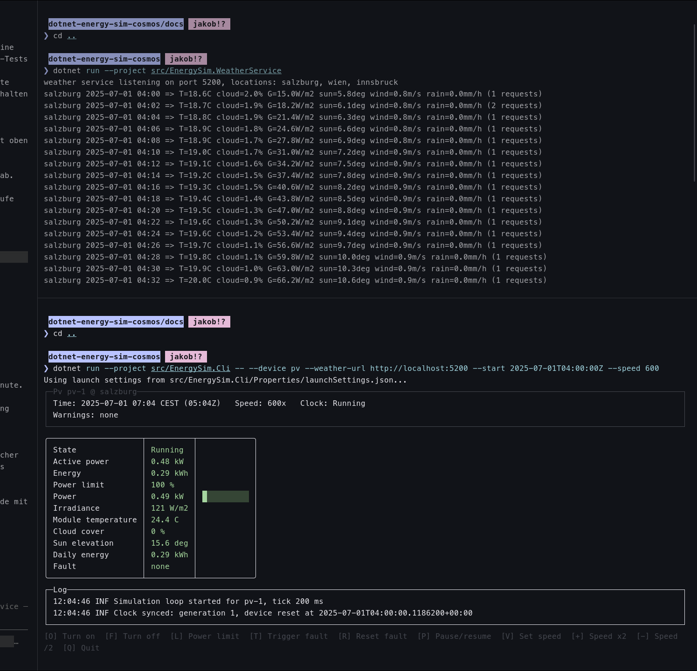

# Entwicklungsjournal – Jakob Ammerer

<!--
Verpflichtende Tags pro Eintrag:

- Done: Was wurde bearbeitet und welches Ergebnis liegt vor?
- KI: Werkzeug, Modell, Einsatzform und Umgang mit dem Ergebnis; bei keiner KI-Nutzung: keine.
- Artefact: Betroffene Dateien, CSV/Kurve, Screenshot, Dokumentation oder andere Ergebnisse.

Optionale Tags bei Relevanz:
- Comment: Entscheidung, Problem, Erkenntnis oder nächster Schritt.
- Test: Durchgeführter manueller oder automatisierter Test.

- KI: Usage Infos:
  - Used to add the artifacts section
  - Tried to work with it the same way as i work with it in the company
  - Formatting console output & exception messages
  - Used for repetitive Coding Tasks
-->

## 09/28/26:

- **Done:** initial creation of repository. Project Structure Setup (Class lib & Cli setup)
- **KI:** Claude Code Sonnet 5.0: Used /grill-me skill to discuss the project structure with claude. Used parts of it, gave clear instructions on how i want the structure to look like. in .claude Decisions.md are design decisions i discussed with claude. The artefacts section in this files is also written by claude cuz im lazy.
- **Artefact:** `src/Uas.Aj.Pv.Simulation/` (solution, `Uas.Aj.Pv.Simulation.Core`, `Uas.Aj.Pv.Simulation.Cli`), `.claude/DECISIONS.md`, `.gitignore`, this journal.

## 09/30/26:

- **Done:**
  - Research about good Console Applications and what to use => came to Spectre.Console: https://spectreconsole.net/
  - Research about what a PV does and what would make sense to simulate
  - Json File with wheater data for 1 week, made a class which inherits form IWeatherService for specific wheater from json wheater implementation
- **KI:** Claude  Sonnet 5 => research about what the PV's does and what worth simulating, Added Exception Handling with Claude Code
- **Artefact:** `data/salzburg-2026-09-23_2026-09-29.json`, `Core/Weather/` (`WeatherSnapshot`, `IWeatherSource`, `JsonFileWeatherSource`), `Core/Simulation/` (`SimulationClock`, `SimulationOptions`), `Cli/Program.cs`.

## 02/10/26 - 03/10/26:

- **Done:** PV plant model (power from irradiance (bestrahlung) + temperature, power limit, fault, on/off, daily/total energy), --check for  manual testing, debug profile
- **KI:** Claude Sonnet 5 => formatting console output, ideas and information on the pvplant. Helping me to figure out how a PV plant model should work. Used grill-me skill on that specific thing. e.g formulas, states which i discussed in my notes
- **Artefacts:** `Core/Device/` (`PvPlant.cs`, `PvPlantConfig.cs`, `PvPlantStatus.cs`), `Cli/PvPlantCheck.cs`, `Cli/Properties/launchSettings.json`, `Cli/Program.cs`

## 04/10/26

- **Done:** Reworked Exception handling, did not like the initial approach with the catch all style. Now Exceptions are there, where they could happen and get handled there. Added SimulationEngine, AutoMode and Manual Mode
- **KI** Claude Sonnet 5 and Opus 5:
  - Used to apply the exceptions the way I wanted it. SimulationEngine.cs
  - gave me the formulas for the cloud drift in auto mode and for how clouds reduce the sunlight. I decided on slow drift instead of pure random and on no seed like the instructions in pdf said "moeglichst realitätsnah". Also helped with implementation of the decorator Pattern. Tested and approved by me.
- **Artefacts:** `Core/Simulation/SimulationEngine.cs`, `Core/Weather/` (`AdjustableWeatherSource.cs`, `WeatherMode.cs`, `JsonFileWeatherSource.cs`), `Cli/PvPlantCheck.cs` (engine + weather cases), `Cli/Program.cs` (DI)

## 04/10/26

- **Done:**
  - CSV history mgmt: one line per tick with time, mode, status, power, energy, power limit, irradiance, clouds, temperature
  - ';' + decimal comma so it opens clean in libre office
  - new file per run in /data/run folder
- **KI:**
  - implemented `HistoryRow`, `IHistoryWriter`, `CsvHistoryWriter` and the check cases from the plan in my notes (columns, one row per tick, file per run)
- **Artefacts:** `Core/History/` (`HistoryRow.cs`, `IHistoryWriter.cs`), `Cli/CsvHistoryWriter.cs`, `Core/Simulation/SimulationEngine.cs` (writes row per tick), `Core/Simulation/SimulationOptions.cs` (`HistoryFolderPath`), `Core/Weather/WeatherSnapshot.cs` (`Mode`), `Cli/PvPlantCheck.cs` (history + csv cases), `Cli/Program.cs` (DI)

## 05/10/26

- **Done:**
  - Console UI with Spectral.Console: live status, (sim time, mode, status, power with bar, energy today/total, limit, irradiance, clouds, temperature) and a bar chart with energy per day
  - Keyboard controls
- **KI:** Claude Code (Sonet 5):
  - implemented `ConsoleAppRunner`, `ArgsParser`, `--help` and the README from my decisions (manual start without args, fixed 10 % steps, daily bar chart, no input menu, no headless mode)
  - tested the runner with simulated key presses, found a crash (empty bar chart in manual mode) and fixed it
- **Artefacts:** `Cli/ConsoleAppRunner.cs`, `Cli/ArgsParser.cs`, `Cli/Program.cs`, `Cli/CsvHistoryWriter.cs`, `Cli/Properties/launchSettings.json`, `Core/Device/PvPlant.cs`, `Core/Simulation/SimulationEngine.cs` (`StepOnce`), `Core/Simulation/SimulationClock.cs`, `README.md`, CSVs in `data/runs/`

## 22/10/26 - 25/10/26 (gitlab down / cert is outdated we were scared to use it)

- **Done:**
  - Weather simulator as its own process (`EnergySim.WeatherService`), HTTP on port 5200, stateless: virtual time comes with leons timesimulator. Decided on HTTP to cover the assignments "zwei getrennte Prozesse müssen miteinander kommunizieren"
  - `HttpWeatherClient` as second `IWeatherClient`: time floored to the minute (same minute = same values), 2 s timeout, last good value flagged stale when the process is gone
  - PV gets weather from the process with `--weather-url http://localhost:5200`, without the option it computes locally as before. Battery and Charger untouched (they need to implement it themself)
  - Weather data: 2025 Salzburg wheater
  - Tested by hand: curl (200/400/404), PV against the process, killed the process while PV ran (PV keeps running on the last value)
- **KI:** Claude Sonnet 5.5 => implementing my decisions after making sure it understands what i really want. I reviewed the diff, ran build, tests and the manual runs. 
- **Artefacts:** `EnergySim.Weather/` (`WeatherApi.cs`, `HttpWeatherClient.cs`, `README.md`), `EnergySim.WeatherService/` (`Program.cs`, `WeatherHttpServer.cs`, `README.md`), `EnergySim.Cli/` (`CliSettings.cs`, `CliRunner.cs`: `--weather-url`), `docs/contracts/weather.md`, `tests/EnergySim.Tests/Weather/WeatherReproducibilityTests.cs`
- **Test run:** weather process (top) and PV with `--weather-url` (bottom), 2025-07-01 04:00Z at x600. The weather log shows one line per minute, PV shows the matching irradiance (121 W/m2) and sun elevation
  
