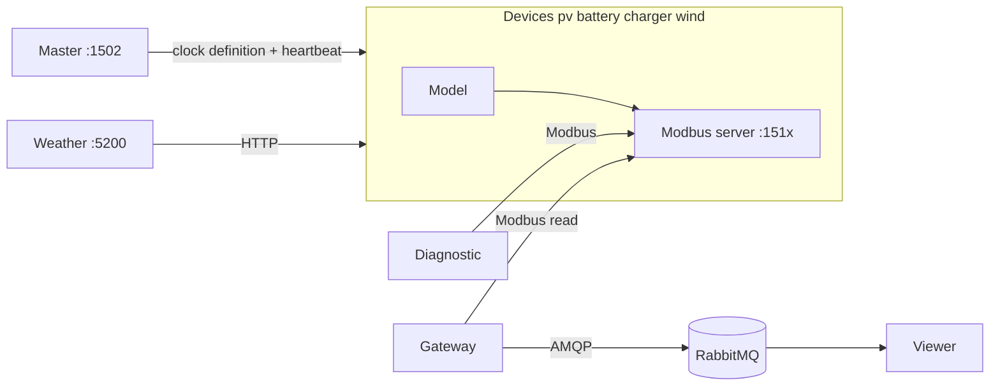
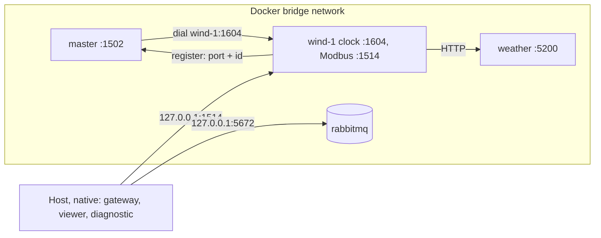

# Architecture

## Processes and ports
| Process | Project | Port |
|---|---|---|
| Master (time) | `Time.Cli` | 1502 Modbus (registration) |
| Weather | `WeatherService` | 5200 HTTP |
| Device clock endpoints | `Cli` | 1601 pv, 1602 battery, 1603 charger, 1604 wind |
| Device Modbus servers | `Cli` | 1511 pv, 1512 battery, 1513 charger, 1514 wind (unit id 1) |
| Diagnostic client | `Diagnostic` | client only |
| Gateway | `Gateway` | client only (Modbus in, AMQP out) |
| Viewer | `Viewer` | client only (AMQP in) |
| RabbitMQ | Docker | 5672 AMQP, 15672 UI (127.0.0.1 only) |
| Portainer | Docker | 9443 web UI (127.0.0.1 only) |

## Data flow

## Containers (LB04)

Service name = device id = host name. Ports are published on `127.0.0.1` only. Guide: [[user-documentation/docker]]. Files: `compose.yaml`, `src/EnergySim.{Time.Cli,WeatherService,Cli}/Dockerfile`, `.dockerignore`.

## Projects
| Project | Purpose |
|---|---|
| `Core` | Device contract, clock model, simulation loop, CSV, register map and codec, weather contract |
| `Weather` | Weather model, data files (3 locations, 2025), HTTP client |
| `WeatherService` | Weather HTTP process |
| `Modbus` | Clock transport, per-device Modbus server, `HeaderSnapshot` (EasyModbus behind async boundary) |
| `Time` | Time authority, participant host |
| `Time.Cli` | Master executable: dashboard, headless |
| `Terminal` | Shared dashboard (Spectre), key source, log buffer, headless writer |
| `Pv`, `Battery`, `Charger`, `Wind` | Model + adapter, reference only `Core` |
| `Cli` | Device executable: composition of clock, model, weather, Modbus server, UI |
| `Diagnostic` | Modbus diagnostic client |
| `Messaging` | Telemetry message, routing, RabbitMQ wrapper (only project with `RabbitMQ.Client`) |
| `Gateway` | Modbus client, publishes device states |
| `Viewer` | RabbitMQ consumer, console output |
| `tests/EnergySim.UnitTests` | xUnit unit tests |
| `tests/EnergySim.IntegrationTests` | xUnit integration tests (real Modbus server + client) |

Reference graph: see `README.md`. Rules: no cycles, everything ends in `Core`, model never references UI or I/O.

## Key mechanisms
- **Virtual time:** master sends definition (anchor, speed, status) at a common future instant + heartbeat every 1 s. Device computes time from definition + monotonic counter. Details: [[architecture/modbus-virtual-time]]
- **Simulation loop:** `DeviceSimulationLoop` ticks every 200 ms real, asks `IClockSource` for virtual time, weather via `IWeatherClient`, pushes frames to sinks (`FanOutSink`: dashboard, Modbus, CSV)
- **Register map:** 17-register header + device block, written by `DeviceModbusSink` per frame. Details: [[contracts/modbus-registers]]
- **Weather:** stateless, client floors time to the minute, last valid value + `stale` on failure. Details: [[contracts/weather]]
- **Gateway:** polls all devices in one loop, `TelemetryMapper` (pure) maps header + values to a message, publishes only on new state. Details: `src/EnergySim.Gateway/README.md`
- **Messaging:** topic exchange, key `telemetry.<type>.<id>`, JSON. Details: [[contracts/messaging]]

## Known limitations
- Clock endpoints loopback by default, Docker bridge network on one host possible. Native devices cannot join a master started with `--dial-device-id`. Participants keyed by host and port
- Weather: 2025 only, 3 locations, 29 Feb maps to 28 Feb
- Device Modbus server: no read lock, torn reads possible (sequence before/after), binds `0.0.0.0`, no authentication
- Gateway: header and device block in 2 requests, devices polled one after another, no buffering during broker outage
- Header time has tick resolution (200 ms real)
- Before `start` devices already show `Running` with power, clock `Stopped`
